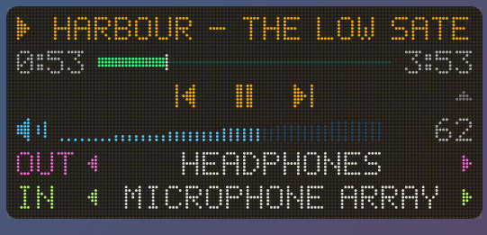
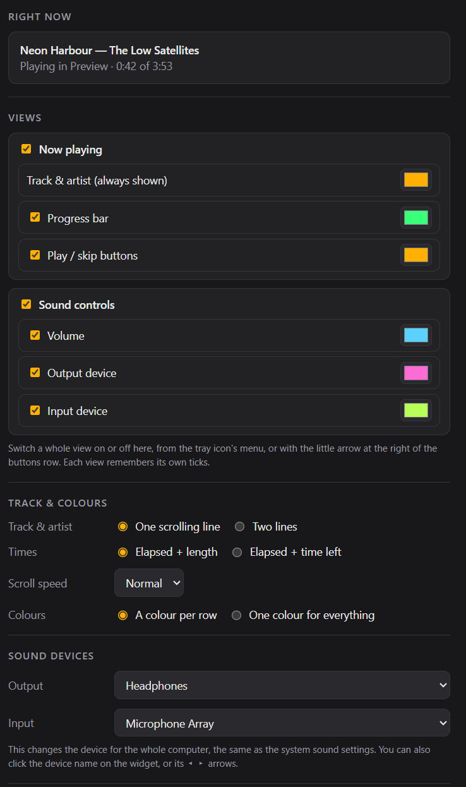

# Dot Player

A dot-matrix "now playing" widget for Windows and macOS, with play/skip buttons, volume and a sound device switcher.

## What it does

It has two views. Switch either one on or off, and use tick boxes to choose rows within each:

| View | Rows |
|---|---|
| **Now playing** | Track and artist (scrolling when too long, on one line or two), **progress bar** with elapsed time and length or time left, **play / pause / skip buttons** |
| **Sound controls** | **Volume** (click to set it, click the speaker to mute, or scroll the mouse wheel anywhere over the widget), **output device** and **input device** (click the name or the ◂ ▸ arrows to switch, and click **IN** to mute the microphone) |

You can switch views in settings, from the tray icon's menu, or with the little arrow at the right of the buttons row.

**More options:**
- **Colours:** one per row, or one colour for everything.
- **Scroll speed:** slow, normal or fast.
- **Matching Dot Clock:** same width, dot size and colours.

## Where it gets the music from

- **Windows:** whatever is playing, from Spotify, a web browser, the Media Player app and most others. It uses the same information as the media panel in Windows' volume flyout.
- **macOS:** **Spotify and Apple Music**. Since macOS 15.4, Apple doesn't let apps read what other apps are playing, so Dot Player asks those two directly. The first time, macOS asks whether Dot Player may control them: click **OK**. Music playing in a web browser can't be shown on a Mac.

Volume and device switching work on both, for the whole computer, the same as the system sound settings.

## Where it lives

The widget doesn't take up a spot on the taskbar (or the Dock on a Mac). It sits in the **system tray** (the menu bar on a Mac) instead. Left-click the tray icon to bring the widget forward, and right-click it to show or hide the widget or the sound controls, open settings, move the widget to the centre of the screen, or quit.

## Privacy

Nothing leaves your computer. Dot Player never connects to the internet.

## Building it yourself

See [BUILDING.md](BUILDING.md). The installer is called `Dot Player_1.0.0_x64_en-US.msi`.

